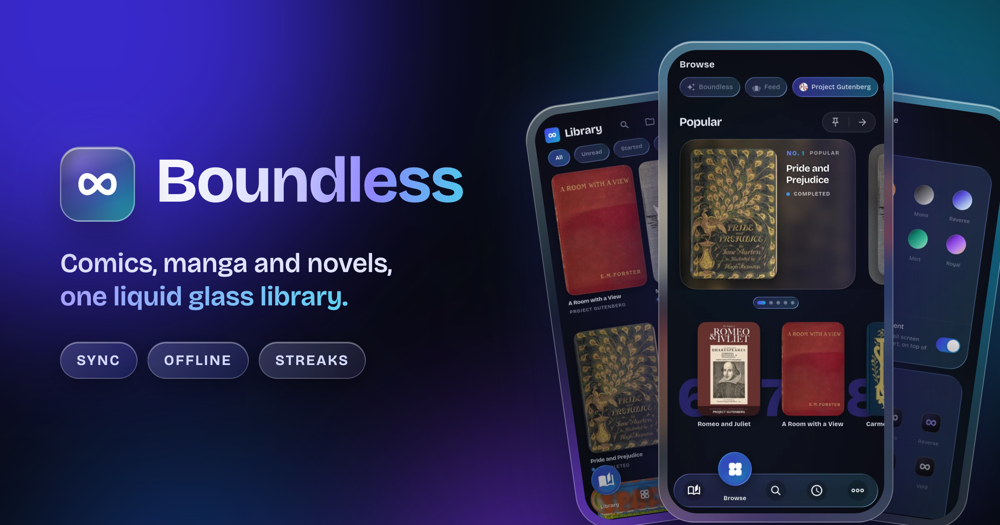
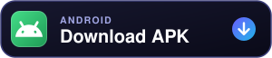
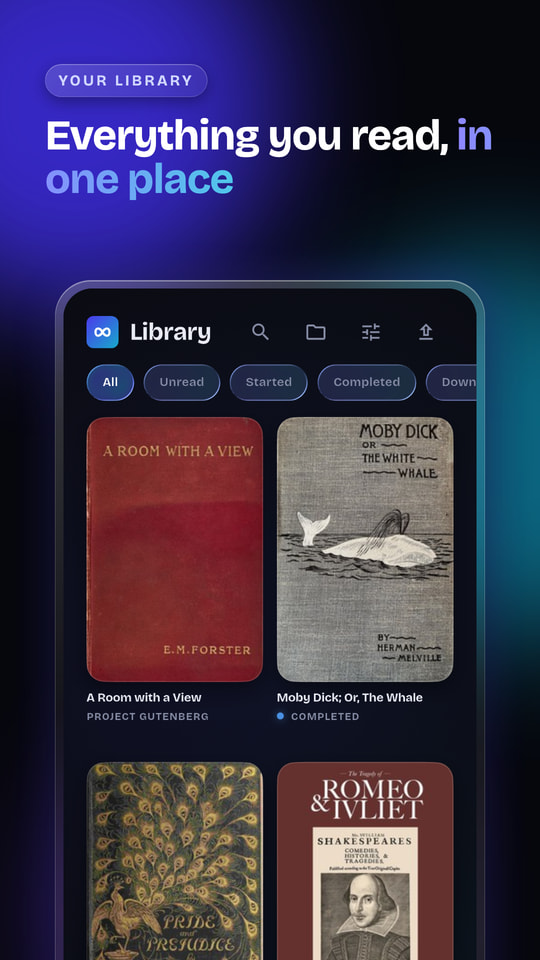
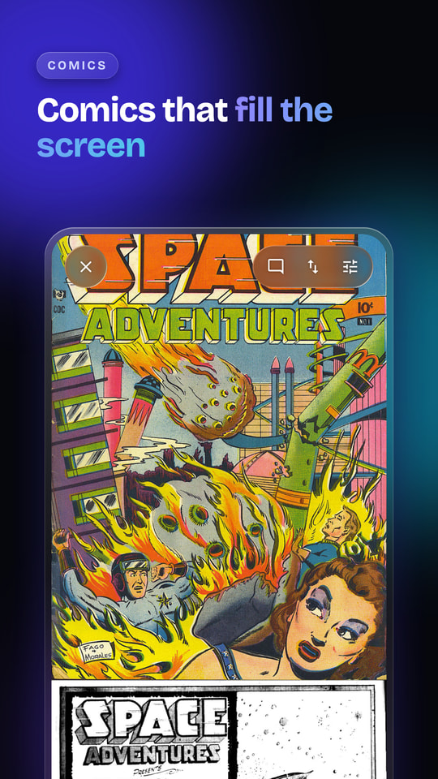
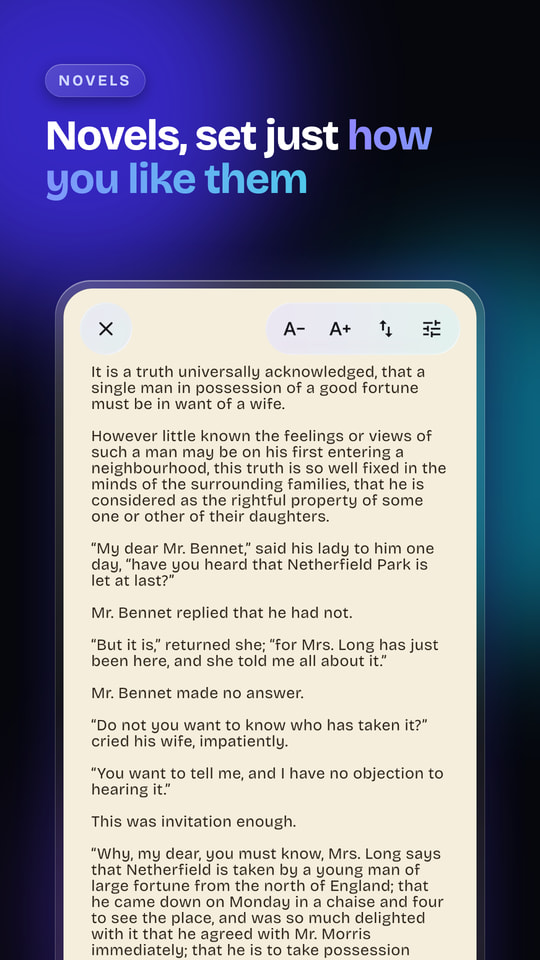
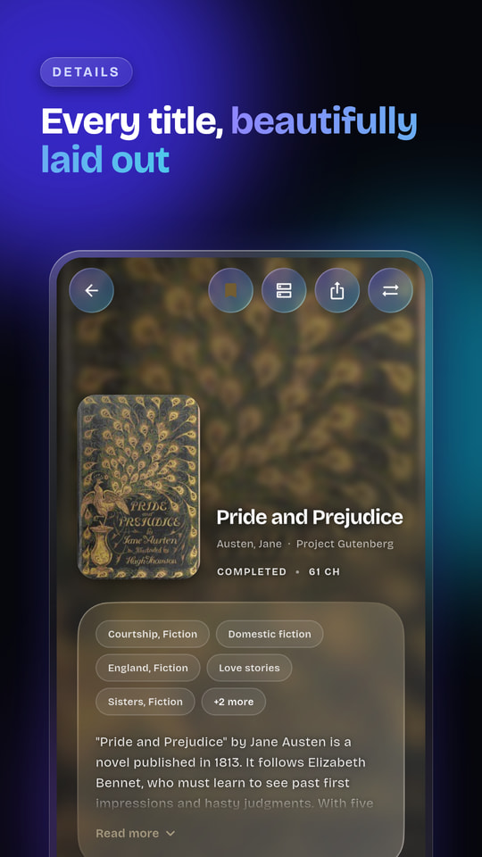
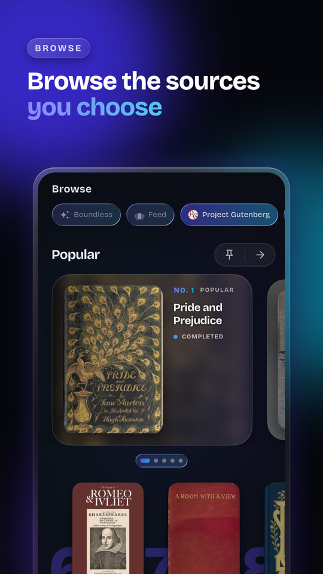
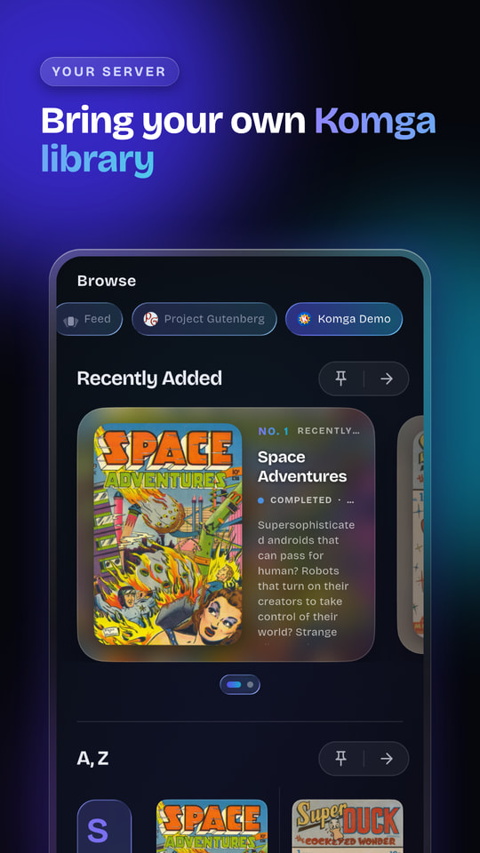
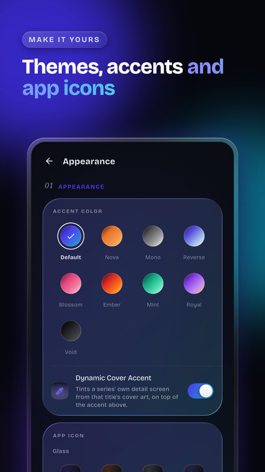

<div align="center">



**The best manga, manhwa, comics and light novel reader.**

On iPhone, iPad, Android and Mac.

<p>
  <a href="https://apps.apple.com/app/id6804857456"></a>
  &nbsp;
  <a href="#google-play-beta"></a>
</p>

<p>
  <a href="https://github.com/BoundlessReader/Boundless/releases/latest"></a>
  &nbsp;
  <a href="https://github.com/BoundlessReader/Boundless/releases/latest"></a>
</p>

[](https://github.com/BoundlessReader/Boundless/releases/latest)
[](https://github.com/BoundlessReader/Boundless/releases)
[](https://discord.gg/BDbk4AYV72)
[](https://boundless.moe)

[Download](#download) · [What's in it](#whats-in-it) · [Docs](https://boundless.moe/docs) · [Report a bug](https://github.com/BoundlessReader/Boundless/issues/new?template=bug_report.yml) · [Request a feature](https://github.com/BoundlessReader/Boundless/issues/new?template=feature_request.yml)

</div>

<br>

<table align="center" width="100%">
  <tr>
    <td align="center" width="25%"><br><sub><b>Library</b><br>Everything you read in one place</sub></td>
    <td align="center" width="25%"><br><sub><b>Comics</b><br>Pages that fill the screen</sub></td>
    <td align="center" width="25%"><br><sub><b>Novels</b><br>Set just how you like them</sub></td>
    <td align="center" width="25%"><br><sub><b>Details</b><br>Every title, beautifully laid out</sub></td>
  </tr>
  <tr>
    <td align="center" width="25%"><br><sub><b>Browse</b><br>The sources you choose</sub></td>
    <td align="center" width="25%"><br><sub><b>Your server</b><br>Bring your own Komga library</sub></td>
    <td align="center" width="25%"><br><sub><b>Appearance</b><br>Themes, accents and app icons</sub></td>
    <td align="center" width="25%"><sub>And more at<br><a href="https://boundless.moe">boundless.moe</a></sub></td>
  </tr>
</table>

## Download

| Platform | Get it |
| --- | --- |
| **iPhone and iPad** | [App Store](https://apps.apple.com/app/id6804857456), for iOS and iPadOS 15.1 or later |
| **Mac** | The DMG from [the latest release](https://github.com/BoundlessReader/Boundless/releases/latest), or the [App Store](https://apps.apple.com/app/id6804857456) on an Apple silicon Mac |
| **Android** | The [Google Play beta](#google-play-beta), or the APK from [the latest release](https://github.com/BoundlessReader/Boundless/releases/latest). `arm64` suits most phones, `universal` works on any |

Updating from an earlier version keeps your library, progress and settings.

### Mac, from Terminal

```bash
bash <(curl -fsSL "https://raw.githubusercontent.com/BoundlessReader/Boundless/main/install.sh")
```

This installs or updates Boundless in /Applications and checks the download against the checksum GitHub publishes for it. Add `--demo` to preview the installer without installing anything. The script is [install.sh](install.sh), so you can read it first.

### Google Play beta

Boundless on Google Play is a closed test for now. Google needs at least 12 testers for 14 days before an app can go public on the Play Store, so joining helps get it there. With the Google account that is on your phone:

1. Join [the Boundless testers group](https://groups.google.com/g/boundless-testers).
2. Open [the testing page](https://play.google.com/apps/testing/moe.boundless) and tap **Become a tester**. That link starts working once Google approves the test build.
3. Install Boundless from [Google Play](https://play.google.com/store/apps/details?id=moe.boundless) and keep it installed for at least 14 days.

Prefer not to wait? The APK in [the latest release](https://github.com/BoundlessReader/Boundless/releases/latest) installs right away. On Android, stick to one channel: an APK from here can't update a Google Play install, or the other way round.

## What's in it

- **Read your way.** Use the sources you add, or your own CBZ, CBR, EPUB and text files.
- **Comics.** Paged, long strip or right to left, with a page curl if you miss paper.
- **Novels.** Scroll or turn like a book, in whatever font and size suit your eyes at 2am.
- **Offline.** Download chapters for the commute.
- **Tracking.** Log what you read on AniList, MyAnimeList, Kitsu, MangaUpdates, MangaBaka, Shikimori or Bangumi.
- **Everywhere.** Your library and your place in every series follow you from phone to tablet to Mac.
- **Cloudflare.** Sites behind Cloudflare mostly just work, so you'll rarely see a "checking your browser" page.
- **Privacy and control.** App Lock, incognito reading and parental controls are there when you want them.

## Help and feedback

- **Something broken?** [Open a bug report](https://github.com/BoundlessReader/Boundless/issues/new?template=bug_report.yml). The error log in Settings helps a lot.
- **Have an idea?** [Suggest a feature](https://github.com/BoundlessReader/Boundless/issues/new?template=feature_request.yml).
- **Questions and chat:** [Discussions](https://github.com/BoundlessReader/Boundless/discussions) or [Discord](https://discord.gg/BDbk4AYV72).
- **Anything private:** support@boundless.moe.

Please search existing issues first, and add a thumbs up to the one that matches yours rather than opening a new one.

## About this repository

This repository hosts release builds, release notes and issue tracking. The source code is not public. Release builds are obfuscated.

Security issues should be reported privately, see [SECURITY.md](SECURITY.md).

<div align="center">
<sub><a href="https://boundless.moe/privacy">Privacy</a> · <a href="https://boundless.moe/terms">Terms</a> · © Boundless. All rights reserved.</sub>
</div>
